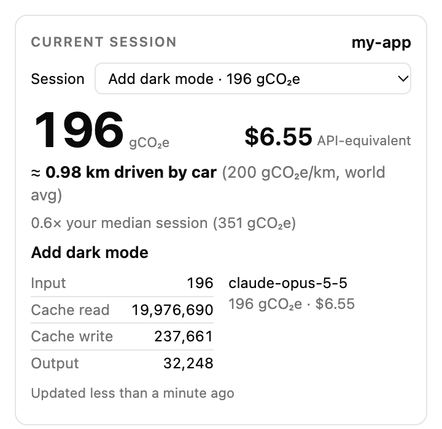

# claude-carbon for Orca

A fork of [gwittebolle/claude-carbon](https://github.com/gwittebolle/claude-carbon) that adds an [Orca](https://github.com/stablyai/orca) plugin.

## Why this fork

claude-carbon shows its CO₂e in the Claude Code status line and in a pane of the Claude desktop app. Neither shows in Orca. This fork adds a native Orca plugin in [`orca/`](orca/): a sidebar panel and a status bar item that track the CO₂e of the Claude Code sessions you run in Orca. The panel shows the current session and your history, and the plugin imports the transcripts already on disk. It uses upstream's factors, prices and methodology unchanged.

<p align="center"></p>

## Quick install

Needs Orca 1.4.248 or newer, with plugins turned on.

```sh
git clone https://github.com/l-peron/claude-carbon-orca-plugin.git
orca plugin dev load ./claude-carbon-orca-plugin/orca --json    # prints the access asked and a fingerprint
orca plugin dev load ./claude-carbon-orca-plugin/orca --json --approve <fingerprint>
```

Then open the panel with `orca plugin open local.claude-carbon --panel carbon`. For what the panel shows, the access the plugin asks for, the settings and the limits, see [orca/README.md](orca/README.md).

## For claude-carbon itself

For claude-carbon itself (install, methodology, CLI, reports and badges), see [upstream's README](https://github.com/gwittebolle/claude-carbon#readme). Everything outside `orca/` in this repository is upstream's, unchanged, including [METHODOLOGY.md](METHODOLOGY.md) and [data/](data/).

## Credit and license

[claude-carbon](https://github.com/gwittebolle/claude-carbon) is by Gaëtan Wittebolle, under the MIT License. The Orca plugin is a community port and is not part of upstream. It is under the same license, and the files copied from upstream keep their MIT notice. See [LICENSE](LICENSE).
