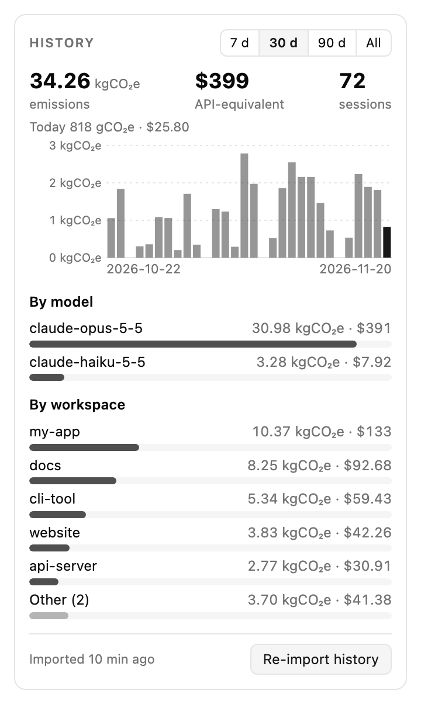

# Claude Carbon for Orca

A community port of [claude-carbon](https://github.com/gwittebolle/claude-carbon) to
[Orca](https://github.com/stablyai/orca). It is not an official claude-carbon or Orca plugin.
It shows the CO₂ and the API-equivalent cost of the Claude Code sessions you run in Orca, in a
sidebar panel and in the status bar. It uses the same factors, prices, formulas and transcript
parsing as claude-carbon, read from this repository's `data/`.

<p>
  
  
</p>

The screenshots use made-up sessions (`docs/render-shots.mts`), with the panel's own HTML.
`docs/panel-dark.png` shows the whole panel in a dark theme.

## What it shows

- **Current session**, for the workspace Orca has in focus. It shows the session's CO₂ (large),
  its API-equivalent cost, a car-distance equivalent from `data/factors.json`, how it compares
  with your median session (as claude-carbon does: the median of all your other sessions, once
  there are 10), the tokens and the CO₂ per model. When the workspace has several Claude Code
  sessions, a picker chooses one: by default the most recently active one, and your choice is
  kept per workspace. A workspace's sessions are those Orca ran in it and those whose folder is
  inside it.
- **History**, over 7 days, 30 days, 90 days or all time. It shows total CO₂, cost and sessions,
  a bar per day (a bar per week past 120 days; the last bar, today's, is stronger) on a gCO₂e or
  kgCO₂e axis, and the split by model and by workspace. Hover over a bar to see its CO₂ and
  cost.
- **Status bar**: the latest session's CO₂ and today's total.

Every amount reads as a number and its unit, `gCO₂e` or `kgCO₂e`.

## How it works

The plugin is a trusted worker and an HTML panel; it has no build step.

- When a Claude Code agent in Orca stops (`agent.status.changed`, state `done`, `waiting` or
  `blocked`), the worker reads `~/.claude/projects/*/<sessionId>.jsonl`, the session's subagent
  transcripts and the agents its workflows started (`subagents/workflows/*/agent-*.jsonl`), as
  claude-carbon does. It sums the assistant `usage` per model and day.
- The worker remembers where it left each file, so a turn costs the bytes it added, not the
  whole transcript again. Files are read a chunk at a time.
- When a workspace comes into focus (`workspace.changed`), the worker lists its agents
  (`agents.list`) and stores their sessions.
- The worker scans every transcript on disk when it starts, at midnight and every 15 minutes,
  so sessions run outside Orca show too. A session whose files have not changed is skipped. The
  first scan shows its progress; **Re-import history** shows the one it starts.
- The worker stores tokens per session, model and day in the plugin's own storage, not CO₂: it
  prices them with claude-carbon's `co2.ts` and `cost.ts` when it shows them, so a new
  `factors.json` or `prices.json` applies to the whole history at once. The storage has a
  schema version; a history from an older version is read again from its transcripts, and a
  session whose transcript is gone keeps the amounts it had.
- A record never replaces one read from newer files, so an import running while a turn ends
  cannot undo that turn.

## Install

Needs Orca 1.4.259 or newer (host API 1.8, which tells which session an agent runs), with plugins turned on (Settings → Plugins).

```sh
git clone https://github.com/l-peron/claude-carbon-orca-plugin.git
orca plugin dev load <path>/claude-carbon-orca-plugin/orca --json
```

The first `dev load` stops with `approval_required` (exit 3). It prints the access the plugin
asks for and a fingerprint. If you agree, run the same command again with that fingerprint:

```sh
orca plugin dev load <path>/claude-carbon-orca-plugin/orca --json --approve <fingerprint>
orca plugin open local.claude-carbon --panel carbon
```

The plugin asks for:

- **trusted-worker**: its own Node.js process, which runs with your user's access to your files.
  The plugin uses this access to read `~/.claude/projects` and `data/`.
- **`agent:read`**: to be notified when an agent's status changes.
- **`workspace:read`**: to know the focused workspace, its agents, and every workspace's name and
  folder (`workspace.list`).
- **`storage:own`**, **`settings:own`**: its own storage and settings.

## Settings

- **Claude Code transcripts folder** (`projectsDir`): if empty, the plugin uses
  `$CLAUDE_CONFIG_DIR/projects`, or `~/.claude/projects` when that variable is not set.
- **Factors folder** (`dataDir`): if empty, the plugin uses this repository's `data/`
  (`../data` from `orca/`), or a `data/` folder beside the plugin when you copy `orca/` alone.
  When neither exists, it uses claude-carbon's built-in defaults.

## Limits

- Only Claude Code sessions are counted. Other agents have no transcript under
  `~/.claude/projects`, so the worker skips them.
- Orca's plugin API gives the focused workspace, not the focused chat or terminal tab. So the
  panel follows the workspace and offers a picker when the workspace has several sessions.
- The worker records a session when its agent stops, so the panel lags behind a turn that is
  still running. Sessions run outside Orca show after the next scan (at most 15 minutes).
- A session that ran in no Orca workspace folder is named in the history by the folder Claude
  Code ran in.
- A day is the worker's local day when the session is read; a session read again after a time
  zone change moves to the new zone's days.
- Within a period, the split by model is estimated: the period's CO₂ is divided in the same
  ratio as the session's model split.
- The car equivalence uses the set that your locale names (`LC_ALL`, `LC_MESSAGES`, `LANG`).
  If none is set, it uses the French set for a French Orca, else the world set.
- The status bar item works only in the Orca desktop app.
- On an Orca before host API 1.8, agents do not say which session they run: the panel says so,
  and sessions show only after a scan.

## Layout

```
orca/
  orca-plugin.json   the manifest
  src/carbon/        the CO₂ and cost math; no Orca or Node API
    co2.ts, cost.ts, equiv.ts   copied unchanged from hooks/mod/lib/ (MIT header kept)
    median.ts        the median a session is compared with, from hooks/mod/lib/
    transcript.ts    transcript usage, ported from CC_JQ_FILE_USAGE (scripts/portable-lib.sh)
    session.ts       totals per model and day from usage rows
  src/files.ts       Node file access: finding transcripts, factors and prices; no Orca API
  src/reader.ts      reads transcripts a chunk at a time, from where each file was left
  src/ingest.ts      a session's files to its stored record
  src/history.ts     the stored records, the schema and its migration, pricing; pure
  src/store.ts       the plugin's storage, in memory and written back on change
  src/workspaces.ts  which workspace a session belongs to, the focused workspace's sessions
  src/insights.ts    today and history per period: totals, bars, by model, by workspace
  src/view.ts        the panel's HTML and CSS as strings, tested in Node
  src/panel.ts       the HTML panel: puts view.ts on the page, handles clicks
  src/worker.ts      the worker: events, scans, status bar, panel requests
  src/protocol.ts    the panel and worker contract
  src/fixtures.ts    transcripts and records for the tests
  docs/              screenshots and the script that renders them
```

## Develop

From `orca/`:

```sh
orca plugin types .           # writes .orca/types/ for tsc
npx -p typescript tsc -p .    # type-check
orca plugin test . --json     # the math (against tests/methodology-vectors*.json), parsing,
                              # files, history, insights, view, worker, panel states
orca plugin validate . --json
orca plugin check . --json
node --experimental-strip-types docs/render-shots.mts /tmp/shots   # screenshot pages
```

## Credits and license

The factors, prices, methodology, golden vectors, `co2.ts`, `cost.ts`, `equiv.ts` and the
median come from [claude-carbon](https://github.com/gwittebolle/claude-carbon) by Gaëtan
Wittebolle, under the MIT License (see `LICENSE` at the repository root). The copied files keep
their MIT notice. The Orca plugin code is under the same license.
